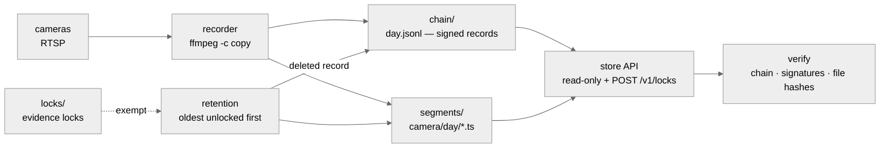
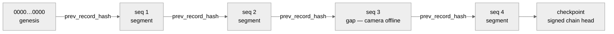

<p align="center">
  <picture>
    <source media="(prefers-color-scheme: dark)" srcset="docs/assets/emblem-mono-white.svg">
    <source media="(prefers-color-scheme: light)" srcset="docs/assets/emblem-mono-black.svg">
    
  </picture>
</p>

<h1 align="center">alecto-notary</h1>

<p align="center">
  <strong>Record it. Sign it. Prove it was not touched.</strong>
</p>

<p align="center">
  <a href="https://github.com/alecto-security/alecto-notary/actions/workflows/ci.yml"></a>
  <a href="LICENSE"></a>
  <a href="https://github.com/alecto-security/alecto-notary/tags"></a>
  
  
</p>

<p align="center">
  Record camera streams continuously, seal every segment in a signed hash chain,<br>
  keep a rolling buffer, and let footage be locked against deletion.<br>
  Footage that went through the Notary can later be <strong>proven unaltered</strong>.
</p>

---

## How it works



The Notary pulls each camera's stream as a **second client** — it never sits
in the camera-to-recorder path, and a crash here cannot touch the site's own
recording. Every segment that closes gets a signed record. Every deletion
gets a signed record too. Missing footage is recorded, never hidden.

## The whole point, in 20 seconds

```console
$ alecto-notary verify
CAM-W01: 1441 records (1400 segments, 3 gaps, 2 deleted) OK
CAM-E02: 1440 records (1438 segments, 2 gaps, 0 deleted) OK

$ alecto-notary verify --public-key 9f3c…b7d1     # auditor mode: public key only
CAM-W01: 1441 records (1400 segments, 3 gaps, 2 deleted) FAILED
  Error seq=812 file=segments/CAM-W01/2026-10-14/221200_812.ts hash mismatch (file changed since sealing)
```

An auditor needs nothing from you except the public key. One flipped byte
names the exact file.

## Quick start

You need Rust stable. ffmpeg + ffprobe on `PATH` for recording and the
end-to-end tests (unit and API tests run without them).

Linux / macOS:

```bash
cargo test                                # unit + API + real-ffmpeg tests (ffmpeg optional, tests skip without it)
cargo run -- keygen --out ./data/device.key
cp notary.example.yaml notary.yaml
export CAM_W01_PASS='...'
export ALECTO_NOTARY_TOKEN="$(openssl rand -hex 24)"
cargo run -- run                          # record, enforce retention, serve the store API
cargo run -- verify                       # chains, signatures, segment hashes
cargo run -- verify --public-key <b64>    # auditor mode: public key only
```

Windows (PowerShell):

```powershell
cargo test
cargo run -- keygen --out ./data/device.key
Copy-Item notary.example.yaml notary.yaml
$env:CAM_W01_PASS = '...'
$env:ALECTO_NOTARY_TOKEN = -join ((48..57) + (97..122) | Get-Random -Count 48 | ForEach-Object { [char]$_ })
cargo run -- run
cargo run -- verify
cargo run -- verify --public-key <b64>
```

## What it is, and is not

| It does | It never does |
|---------|---------------|
| pull each camera's stream as a second client (`ffmpeg -c copy`, byte-exact) | sit in the camera-to-recorder video path |
| hash, chain and sign every segment (Ed25519) | transcode or modify the footage |
| record gaps and deletions as signed records | hide missing footage |
| delete only unlocked segments, oldest first | delete anything under an evidence lock |
| serve segments and records read-only | take credentials in config files or URIs |

## Layout on disk

```text
<root>/segments/<camera>/<YYYY-MM-DD>/<HHMMSS>_<seq>.ts
<root>/chain/<camera>/<YYYY-MM-DD>.jsonl      signed records, one per line
<root>/spool/<camera>/                        ffmpeg output before sealing
<root>/locks/<id>.json                        evidence locks
<root>/audit.jsonl                            who locked, unlocked, deleted
```

## Contract C2: the record format

Every record is one JSON object per line, canonicalized (sorted keys, no
whitespace), signed with Ed25519. Each record's `record_hash` (SHA-256 of
the canonical record including `sig`) is what the next record points back
to:



- Spec: [docs/SPEC.md](docs/SPEC.md). Canonicalization: `src/record.rs`.
- Test vectors: `testvectors/segment-record.json` — a conforming verifier
  reproduces every hash and signature in that file without importing this
  code. [docs/SPEC.md](docs/SPEC.md) pins each vector file's SHA-256, and CI
  fails on any mismatch.
- Kinds: `segment`, `gap` (explicit, with reason), `deleted` (proof stays
  after the file is removed), `checkpoint` (signed chain head).

## Store API (loopback + bearer token)

| Route | Purpose |
|-------|---------|
| `GET /v1/status` | device id, key id, chain head per camera |
| `GET /v1/cameras` | cameras recorded |
| `GET /v1/pubkey` | device public key |
| `GET /v1/segments?camera=&from=&to=` | contiguous record slice (segments, gaps, deletions) overlapping the window |
| `GET /v1/segments/{camera}/{seq}/file` | segment bytes, `x-segment-sha256` header |
| `POST /v1/locks` | `{camera, from, to, case_id, actor, reason}` |
| `GET /v1/locks`, `DELETE /v1/locks/{id}?actor=` | list, release |

## Known limits (stated, not hidden)

- **The signing key sits in a file** (`0600` on Linux). Someone with root on the box can rewrite history and re-sign it. Secure-element storage is the planned fix. Until then, copy `checkpoint` output off the box regularly: it exposes tail truncation and rewrites.
- **Tail truncation is only detectable against an off-box copy** of a signed head. Deleting the newest records leaves a valid shorter chain.
- **Loopback only.** The API refuses non-loopback binds until TLS is implemented.
- **Time comes from the host clock.** Every record carries `clock.source`; measured skew (`skew_ms`) is not populated yet.
- **Hard kills:** a `kill -9` or `taskkill /F` of the Notary can leave its ffmpeg children running. Run it under systemd with `KillMode=control-group`. File names carry a per-launch id, so an orphan cannot collide with the next run, and leftover spool files are sealed on the next start.
- **Orphans:** a crash between moving a segment and writing its record leaves a file the chain does not mention. `verify` reports these as warnings.
- **Storage planning:** 1 TB holds about 6 to 12 days of one 8MP stream. Set `max_age_days` and `max_bytes` from real bitrates.

## Security

Vulnerability reports: see [SECURITY.md](SECURITY.md). Known limitations are listed above — a duplicate report about them is welcome but is feature work, not a vulnerability.

## Releases

Releases are tagged `vX.Y.Z` (semver) on `main`, after CI is green. See the
[tags](https://github.com/alecto-security/alecto-notary/tags),
[CHANGELOG.md](CHANGELOG.md), and the version policy in
[CONTRIBUTING.md](CONTRIBUTING.md).

## License

Apache-2.0. See [LICENSE](LICENSE).

---

<p align="center">
  <sub>Built by <a href="https://github.com/alecto-security">Alecto Security</a>. We move first.</sub>
</p>
